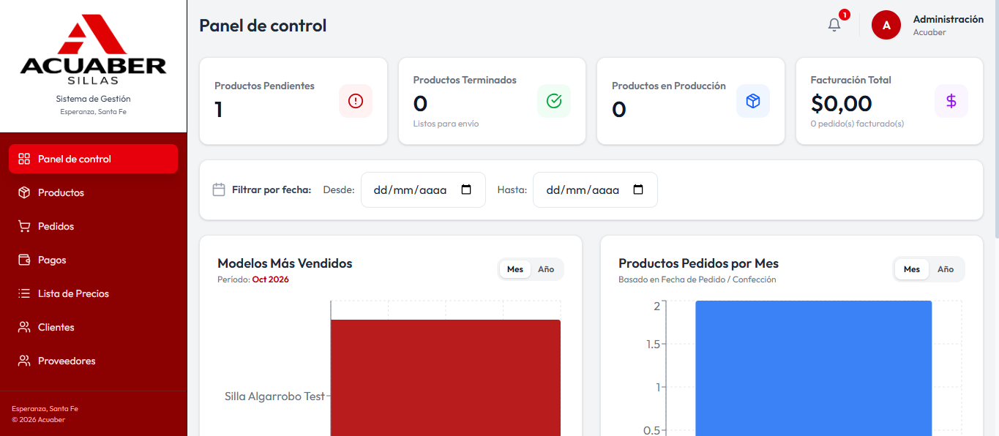
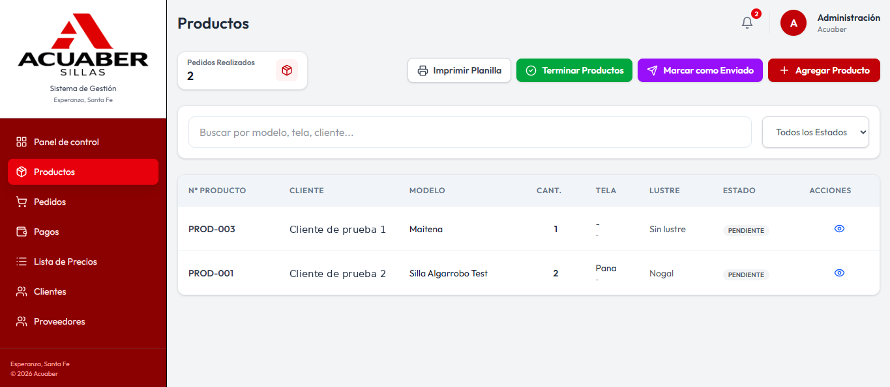
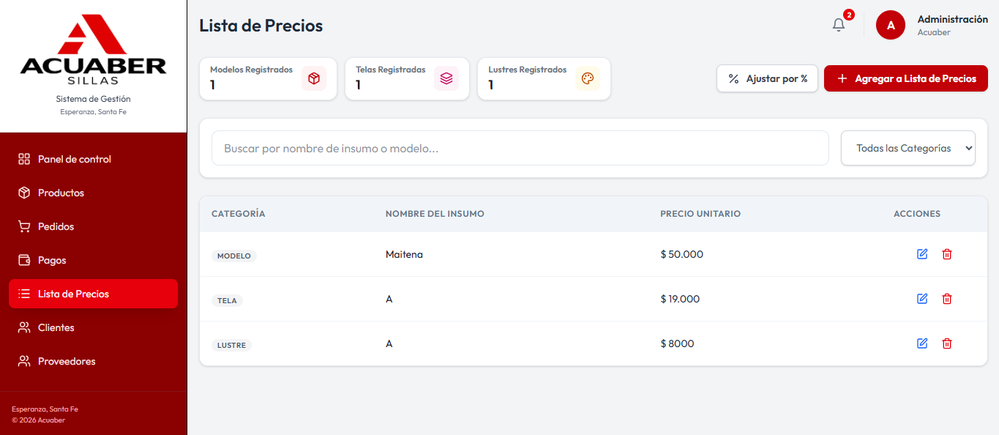
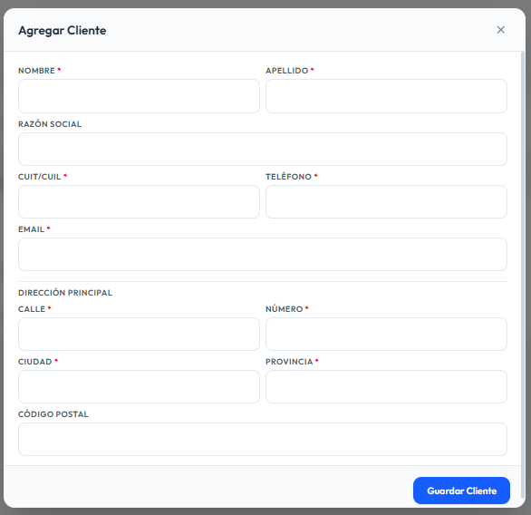
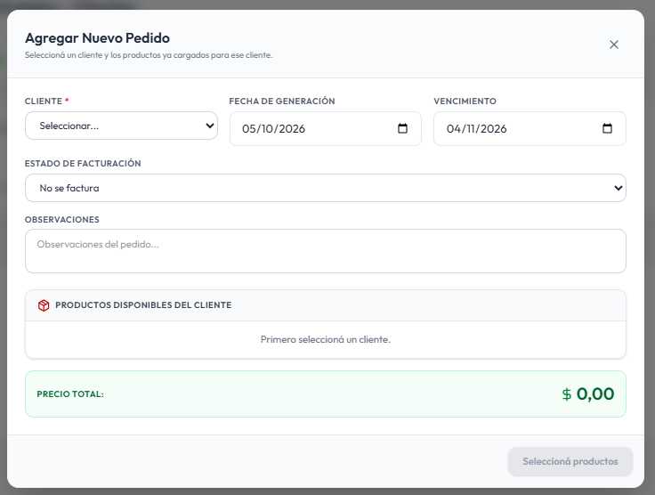
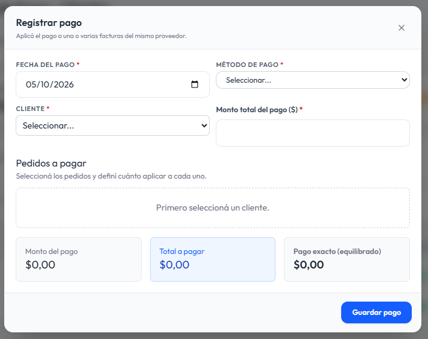

# AcuApp

### Sistema de Gestión Administrativa para Fábrica de Sillas y Sillones

**Proyecto final · Tecnicatura Superior en Desarrollo de Software**  
**ITEC El Molino · Esperanza, Santa Fe, Argentina · 2026**

Desarrollamos **AcuApp** como proyecto final de nuestra carrera, tomando como referencia los procesos administrativos de **Acuaber**, una fábrica de sillas y sillones. Nuestro objetivo fue integrar en una sola aplicación la información de producción, pedidos, clientes, proveedores y operaciones económicas, facilitando la gestión diaria y el seguimiento de cada proceso.

La solución combina una **interfaz en React**, una **API REST con Node.js y Express**, una **base de datos PostgreSQL** y una **aplicación de escritorio mediante Electron**.



## Funcionalidades

| Área | Qué permite realizar |
| --- | --- |
| **Panel de control** | Consultar indicadores de producción y facturación, gráficos, avisos de pagos pendientes y herramientas de respaldo y restauración. |
| **Productos y producción** | Registrar y consultar productos, filtrar por estado, editar registros, generar planillas y seguir los estados pendiente, en producción, terminado y enviado. |
| **Insumos y precios** | Administrar insumos y actualizar valores individualmente o mediante ajustes porcentuales. |
| **Clientes** | Registrar y editar clientes y direcciones, consultar sus pedidos, movimientos, pagos y saldos; bloquear o reactivar registros. |
| **Proveedores** | Gestionar proveedores y consultar sus facturas, pagos, movimientos y saldos. |
| **Pedidos de clientes** | Crear y editar pedidos, asociar productos disponibles, gestionar información de facturación y generar documentos PDF. |
| **Facturas y remitos** | Registrar comprobantes de proveedores, asociar archivos y consultar su estado de pago. |
| **Pagos y cuentas corrientes** | Registrar pagos de clientes y proveedores, aplicar pagos totales o parciales y consultar saldos pendientes y a favor. |

### Reglas de negocio relevantes

- El estado de los productos refleja su avance en el circuito de producción y envío.
- Los pedidos se vinculan con clientes y productos disponibles; los estados de producción y de pago se gestionan por separado.
- Los pagos se aplican a pedidos o facturas y actualizan los movimientos y saldos correspondientes.
- Para preservar la trazabilidad, los clientes y proveedores que poseen movimientos asociados pueden bloquearse en lugar de eliminarse definitivamente.

## Capturas del sistema

| Productos y seguimiento de producción | Lista de precios e insumos |
| :---: | :---: |
|  |  |

| Registro de clientes | Creación de pedidos |
| :---: | :---: |
|  |  |

**Registro de pagos:**

<p align="center"></p>

## Tecnologías y arquitectura

| Componente | Tecnologías |
| --- | --- |
| **Interfaz** | JavaScript, React, Vite, Tailwind CSS |
| **Backend y servicios** | Node.js, Express, API REST |
| **Persistencia** | PostgreSQL y consultas SQL |
| **Aplicación de escritorio** | Electron, Electron Builder |
| **Gráficos** | Recharts |
| **Desarrollo colaborativo** | Git y GitHub |

La interfaz consume los servicios del backend, que concentran la lógica de negocio y las operaciones sobre la base de datos. Electron permite utilizar la aplicación como programa de escritorio.

```text
Practicas-Profesionalizantes/
├── assets/                 # Recursos gráficos
├── database/               # Scripts SQL del proyecto
├── src/
│   ├── backend/
│   │   ├── config/          # Configuración del servidor y base de datos
│   │   ├── controllers/     # Lógica de negocio
│   │   ├── routes/          # Endpoints REST
│   │   └── server.js        # Servidor Express
│   ├── electron/            # Integración con Electron
│   └── frontend/            # Aplicación React
├── docs/images/             # Capturas preparadas para esta documentación
├── package.json
└── README.md
```

## Ejecución en entorno de desarrollo

### Requisitos

- **Node.js 20 o superior**, npm y Git.
- Una base PostgreSQL **de prueba** con sus credenciales configuradas localmente.

### Instalación y ejecución local

1. Clonar el proyecto:

   ```bash
   git clone https://github.com/Ignagatti/Practicas-Profesionalizantes.git
   cd Practicas-Profesionalizantes
   ```

2. Instalar dependencias:

   ```bash
   npm install
   ```

3. Configurar un archivo **`.env` local y no versionado** con las variables necesarias para la conexión de desarrollo. Consultar la plantilla `.env.example`.

4. Iniciar frontend y backend:

   ```bash
   npm run dev
   ```

Este comando inicia los servicios para trabajar en desarrollo. **No proporciona por sí solo una base de datos ni una licencia de demostración.** 

## Equipo y contribuciones

Este sistema fue desarrollado de manera **colaborativa** por estudiantes de la Tecnicatura Superior en Desarrollo de Software del ITEC El Molino. Durante el proyecto compartimos tareas de desarrollo, integración, relevamiento, pruebas y documentación.

| Integrante | Principales aportes |
| --- | --- |
| **[Micaela Cammisi](https://github.com/MCammisiMicaela)** | Desarrollo e integración de funcionalidades de **clientes y pedidos** (frontend/backend), ajustes relacionados con proveedores y datos, mejoras de interfaz y pruebas funcionales manuales. |
| **[Ivana Bertram](https://github.com/ivanabertram)** | Principalmente **relevamiento de requerimientos y documentación funcional y de usuario**; también aportes de código al frontend de clientes, proveedores y precios, y a funcionalidades relacionadas con facturas, pagos y movimientos. |
| **[Ignacio Gatti](https://github.com/Ignagatti)** | Desarrollo e integración de módulos, configuración técnica y de la base de datos, implementación y ajustes de funcionalidades, interfaz, mantenimiento y empaquetado con Electron. |

---

**AcuApp · Proyecto académico colaborativo · ITEC El Molino · 2026**
